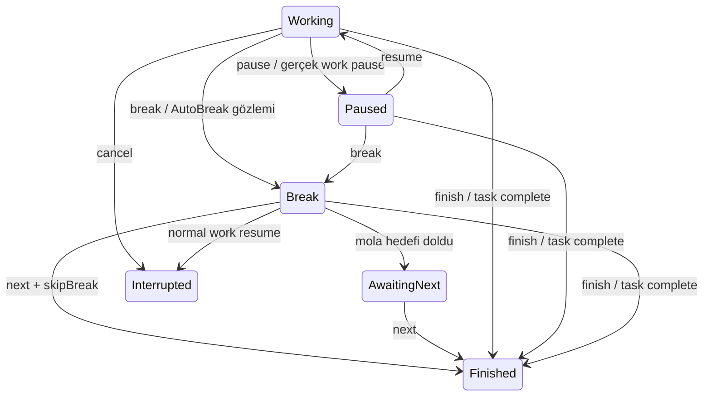

# Focus ve Pomodoro — MVP-22

Focus bir gerçek çalışma kaynağı daha değildir. Bir FocusSession, tek WorkSession'ın belirli çalışma döngüsünü hedef ve mola bağlamıyla işaretler. Süre WorkSessionSegments üzerinden focus başlangıcı/çalışma bitişi kesişimiyle hesaplanır. Önceki çalışma, pause ve mola eklenmez. Aynı work birkaç focus döngüsünde sürse de actual yalnız bir kez sayılır.

## API

- `GET /api/focus-presets?offset=0&limit=50`: kullanıcı preset'leri ve kayıt oluşturmayan15/5,25/5,45/10 builtIns. Liste limiti1..100, offset0..100000.
- `POST /api/focus-presets {name,settings}`; `PUT /api/focus-presets/{id} {version,name,settings}`. Settings: workSeconds, shortBreakSeconds, longBreakSeconds, longBreakEvery, targetBehavior (`ContinueTracking` veya `AutoBreak`), soundEnabled, notificationsEnabled.35/7 veya5dk hedef geçerlidir. Çalışma1..86400sn, kısa mola1..14400sn, uzun mola1..43200sn, sıklık1..20. Sound/notifications tercihleri saklanır; gerçek browser/push teslimi26 ve frontend kapsamındadır.
- `POST /api/focus-sessions {taskId?,workSessionId?,workSessionVersion?,presetId?,settings?}` + Idempotency-Key. PresetId ve settings birlikte verilmez. Varsayılan25/5, uzun mola15dk/her4döngü, ContinueTracking. Task verilmezse genel odak: nullable TaskId'li gerçek WorkSession oluşur. Günlük actual'a girer, uydurma task'a yazılmaz.
- Mevcut Running/Paused work'e bağlanmak için workSessionId ve version birlikte gerekir; paused ise aynı transaction'da resume edilir. TaskId ayrıca verilmişse work göreviyle eşleşmelidir. Önceki work dakikaları focus hedefini tüketmez. Planlı work'in başlangıç schedule/revision-item bağlamı korunur.
- `GET /api/focus-sessions/current`; `GET /api/focus-sessions/{id}`; bounded `GET /api/focus-sessions?offset&limit`. Current/Get serverNow ile aktif durumu değerlendirir ve bir kez target gözlemini/due geçişi kaydedebilir; list tarihsel kayıtları ve effective ölçümü gösterir. İstemci aktif odak için current/get kullanır; her tick DB mutation değildir.
- `POST /api/focus-sessions/{id}/pause|resume|break|next|finish|cancel {version,workSessionVersion,skipBreak?}` + key. Her eylem focus ve work sürümlerini kontrol eder. Replay aynı receipt'i döndürür; aynı key farklı payload ile409. Focus resume başka aktif work'i kesmez; mevcut Work guard'ları/gerçek dependency uygulanır.

## State machine

Next önceki FocusSession'ı kapatıp aynı WorkSession üzerinde yeni FocusSession açar; previousFocusId, artırılmış cycleNumber ve aynı immutable preset snapshot taşır. Bu iki kayıt, work resume, task olayı, planningVersion ve key tek transaction'dadır. Mola bitmeden next için skipBreak=true gerekir. Mola dolması yalnız AwaitingNext durumuna geçer; sonraki gerçek çalışma **daima açık next eylemi** ister. Her sıklık katında uzun mola, diğer döngülerde kısa mola seçilir. Kullanıcının erken bitirdiği/atladığı döngü de cycleNumber sırasını ilerletir; başarı/streak puanı değildir.

Finish/cancel actual'ı korur, work'i finish yapar; task Paused kalır, Completed olmaz. Task complete/defer/cancel mevcut WorkLifecycle üzerinden work ve aktif focus'u aynı transaction'da kapatır. Düz work pause/resume focus working/paused durumuyla eşleşir. Acil start eski focus'u pause eder; yeni işe odak döngüsü uydurmaz. Break sırasında düz work resume, eski focus'u Interrupted yapar; gizlice yeni Pomodoro döngüsü başlatmaz.

## Hedef, aşım ve otomatik geçiş

Varsayılan ContinueTracking: hedefte WorkSession/Task durumu değişmez, gerçek segment devam eder. Remaining sıfırda kalır, overtime artar. Pause hedef aktif süresini tüketmez. TargetReachedAt kesintiler dahil gerçek segmentlerden hesaplanan ilk hedef instant'ı; TargetObservedAt sunucunun bunu kaydettiği zamandır. TargetEventId, hedef kaydı varsa FocusSession.Id'dir: paralel okuyucular/reload/restart yeni mantıksal hedef olayı oluşturmaz. Bildirim altyapısı daha sonra bu kimliği kullanır.

AutoBreak, ContinueTracking ile aynı anda seçilemeyen alternatif enum değeridir. Bu pakette kalıcı scheduler yoktur: **current/get sunucu değerlendirmesinde** hedef aşılmışsa o an açık segment kapanır, mola o an başlar. Saatlerce bağlantı olmamışsa geçmiş actual hedef anında kesilmiş gibi yeniden yazılmaz; gerçekten kaydedilmiş taşma korunur. Kalıcı değerlendirme job'ı25'te, bildirim26'da bağlanır. Bu aşama dakikasında background alarm garantisi vermez. Açık pause/break/finish komutu otomatik değerlendirmeye göre önceliklidir; hedef kaydı yine bir kez korunur.

Mola ve target hesapları client saatine dayanmaz; serverNow senkronizasyonu DTO'dadır. Sunucu önceki çalışma anından gerideyse409. Mola elapsed hedefte kesilir, AwaitingNext bekleme süresi iş veya mola toplamını şişirmez. Preset'in sonradan düzenlenmesi başlamış odak ayarlarını değiştirmez.

Correction effective segmenti değiştirince focus active/remaining/overtime da yeniden hesaplanır. Daha önce kaydedilmiş target olayı geçmiş gözlem olarak korunur; `effectiveTargetReached` düzeltilmiş sürenin bugün hedefe yetip yetmediğini ayrıca gösterir. Journal ikinci zaman kaynağı değildir. Plan undo focus/work/correction'ı geri almaz.

## Kalıcılık ve sınırlar

Kullanıcı başına tek aktif focus DB partial unique index ile de korunur. Owner+WorkSession, owner+preset ve owner+previousFocus composite FK'leri yabancı bağları engeller. PreviousFocusId unique olduğundan aynı döngü iki farklı next üretmez. Tek açık gerçek çalışma segmenti mevcut PostgreSQL unique/exclusion kısıtlarıyla korunur. Bütün kritik yazmalar kısa user coordination lock altında atomiktir; domain süre hesabı DB/HTTP'ye bağımlı değildir.

Bu paket backend state/ölçüm doğruluğudur. Browser sesi, izin isteme, push teslimi ve görünür Focus Mode paneli tamamlanmış sayılmaz.

Bağımsız genel odakta görev tahmini olmadığı için focus hedefi gerçek çalışma bitişi kabul edilmez. Genel work Running iken otomatik plan/distribution/undo snapshot'ı `409/general_work_active` ile açık duraklatma ister; plan veya actual sessizce değişmez. Acil start-now, beklenen work kimliği/sürümüyle genel çalışmayı açıkça kesip task'a geçebilir. Takvim ve manuel plan okumaları kullanılabilir.
